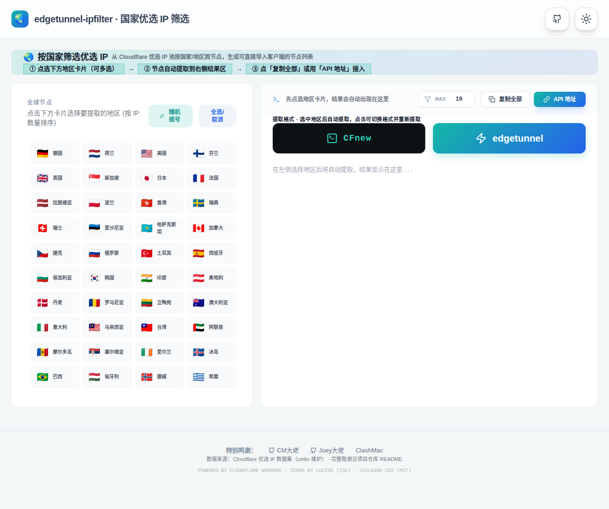

<div align="center">

# edgetunnel-ipfilter

**edgetunnel + country-specific Cloudflare IP filter, merged into ONE single-file Worker.**

Deploy once, get both: the full edgetunnel proxy, and a built-in preferred-IP filter that serves region-filtered IP lists from the very same domain.

<p style="color: #ff4d4f; font-weight: bold;">
Non-profit project. No commercial use. Please comply with local laws and regulations; binding a custom domain is recommended.
</p>

</div>

**English** · [中文版](#中文版)

## Quick start

1. **Deploy** with any method in the deployment section below, and bind your custom domain.
2. **Log in**: open `https://<your-domain>/admin`. The password is the `UUID` variable you set at deploy time (if you also set an `ADMIN` variable, use that instead).
3. **Pick regions**: in the admin panel, open 「优选生成」 and tick the countries/regions you want.
4. **Get your subscription**: open 「订阅」, copy the subscription link (or scan the QR code), import it into your client (Clash / sing-box / Shadowrocket …) and update — if nodes show up, you are done. The overview page has a four-step first-run guide.

## What is merged

| Part | Source | Notes |
| --- | --- | --- |
| Proxy core | [cmliu/edgetunnel](https://github.com/cmliu/edgetunnel) (via [dukangalex/edgetunnel](https://github.com/dukangalex/edgetunnel), version 2026-10-08) | Original routes and behavior preserved; four surgical patches (below) wire in the filter and optimize hot paths. |
| IP filter module (IPF) | [dukangalex/Cloudflare-Country-Specific-IP-Filter](https://github.com/dukangalex/Cloudflare-Country-Specific-IP-Filter) (optimized edition) | Inlined into the same `_worker.js` with `IPF_` prefix isolation; if the module ever errors, it steps aside and the proxy keeps working. |
| Proxy checker module (CHK) | [dukangalex/CF-Workers-CheckSocks5](https://github.com/dukangalex/CF-Workers-CheckSocks5) | Wrapped in an IIFE (zero symbol leakage) behind the admin login; serves the deployment itself (own nodes, configured upstream). |
| Subscription converter module (CHN) | [dukangalex/subscription-chain-converter-cf](https://github.com/dukangalex/subscription-chain-converter-cf) | The deployment's conversion interface and its default converter (all six formats native in-process, chaining included, zero external dependencies). |

**The originals stay originals.** All four source projects remain independent, with their own repositories and their own development — this repository is a separate, new project. It vendors snapshots of them into one Worker through a reproducible merge build: nothing here modifies the originals, and when a source project improves, the improvement flows in on the next rebuild. If you only need one of the parts, use its original project; if you want them working together as one deployment, use this one.

The filter's data layer comes with the optimizations from the standalone project: the upstream list (~16k lines from [zip.cm.edu.kg](https://zip.cm.edu.kg/all.txt)) is parsed once and cached for 5 minutes instead of being fetched on every request, sampling is unbiased, duplicate/invalid entries (`#Unknown` etc.) are filtered out, and the last good dataset is served if the upstream hiccups.

Integration & optimization patches on the proxy core (all injected by `merge.py` as anchored patches; if the upstream structure changes, the build fails loudly instead of silently producing a wrong build):

1. **`ipf://` in-process expansion** — subscription generation expands `ipf://` entries in the preferred-IP list through the filter module directly (see below), and the list source is read from KV once instead of twice.
2. **Config cache** — `config.json` is cached as raw text in-isolate for 30 s instead of one KV read per request (proxy handshakes included); admin saves invalidate it immediately.
3. **Conversion retry** — a failed subscription-conversion backend call is retried once before an error is surfaced.

## IP filter usage

Web UI: open **`https://<your-domain>/ips-ui`**, pick regions, copy ready-made links.

| Route | Format | Description |
| --- | --- | --- |
| `/ips/JP-US?limit=10` | `line` (default; override with `?format=`) | Native path of this project. |
| `/edgetunnel/JP-US?limit=10` | `line` | Compatible with links generated by the standalone filter. |
| `/CFnew/JP-US?limit=10` | `cf_line_short` | Same, CFnew style. |
| `/?api=1&region=JP,US&format=cf_line_short&limit=10` | per `format` | Query-style API. |
| `/?get_regions=1` | JSON | All region codes sorted by IP count. |

Common parameters: `limit` = max IPs per region (0 = unlimited), `base64=1` = base64-encode the output.

Formats: `line` · `cf_line` · `cf_line_short` · `cf_comma_short` — see the standalone filter's README for samples.

**Feed the filter into edgetunnel's own subscriptions**: the two halves are wired together inside the process. In the admin panel, set the custom preferred-IP list (KV `ADD.txt`) to an `ipf://` entry and turn OFF random-IP mode in the subscription-generation settings:

```text
ipf://JP-HK-SG-US?limit=10
```

Every `/sub` generation then expands that entry in-process into fresh country-filtered IPs from the built-in module (regions separated by `-`, `limit` = max per region). No HTTP self-request is involved — Cloudflare forbids a Worker from fetching its own routes, so the older "paste your own filter URL into ADD" approach cannot work from the same deployment; `ipf://` is the supported way. One deployment is fully self-contained: proxy, filter and subscription source in a single `_worker.js`.

#### Your regions, your counts

The `ipf://JP-HK-SG-US?limit=10` line is only the shipped default — nothing about it is hard-coded. The entry is plain data in the preferred-IP list, so every deployer chooses freely. Fresh deployments even work out of the box: random-IP mode now defaults to OFF in this project, and with no custom list set, the default entry above is used automatically.

| Want | Write |
| --- | --- |
| Only Japan, 20 nodes | `ipf://JP?limit=20` |
| Five regions, 5 each | `ipf://JP-HK-SG-TW-KR?limit=5` |
| A region with no cap | `ipf://DE?limit=0` |
| Different caps per set | two lines: `ipf://JP?limit=20` + `ipf://US-DE?limit=5` |
| Filtered + hand-picked mixed | add plain lines like `1.2.3.4:443#MyNode` next to the `ipf://` lines |

- **Upstream admin UI, self-hosted, with fused modules**: the admin (`/admin`) and login (`/login`) pages are the upstream project's EDT-Pages pages, vendored into the Worker and served by the deployment itself (nothing is fetched from the Pages site at runtime), so upstream users keep their exact operating habits and every upstream feature. This project's additions are fused into the features themselves: region filtering is a fourth mode of the preferred-subscription module (alongside generator / random / custom — tick regions, set the count, the module's own Save persists it), and the chain entry is a plain field of the subscription-conversion module.
- **Living pool**: subscription generation probes every candidate in-process before serving it — dead IPs are dropped, the fastest live ones win, and results are remembered in a KV health registry, so the pool keeps healing itself through ordinary use (no cron, no setup). The card displays pool vitality live.
- **Built-in subscription converter**: [subscription-chain-converter-cf](https://github.com/dukangalex/subscription-chain-converter-cf) integrated as the conversion interface. All six formats covered, **all of them generated natively in-process** (since integration 2.0): Clash / Mihomo, sing-box, V2Ray, Surge, Loon and Quantumult X — including chain-proxy structuring in every format that can express it — with **zero external dependencies**; no conversion ever leaves the deployment. **This built-in converter is the default**: edgetunnel's admin 订阅转换后端 field ships empty, and empty means built-in — type an external backend address there only if you want to override it. Force built-in even with a backend set via `订阅转换配置.内置转换: true`, and set `订阅转换配置.链式入口` (an entry subscription URL or `|`-separated node links) to get chained output. The login and converter pages carry this project's repository and channel links. Converter page at `/convert`, short links via `POST /shorten` → `/m|s|c/<code>`, direct endpoints `/conv`, `/chain`, `/sub?url=`. Rule files mirror lazily into the KV under `/rules/…`; warm them all with an admin-authenticated `POST /rules-refresh`.
- **Built-in proxy checker**: [CF-Workers-CheckSocks5](https://github.com/dukangalex/CF-Workers-CheckSocks5) integrated — page at `/socks5-ui`, checking SOCKS5 / HTTP / HTTPS / TURN / SSTP proxies (single & batch, exit-IP info, latency). Unlike upstream, which ships unauthenticated, every checker route here requires the deployment's admin login. The admin tools card links to it; unauthenticated visits redirect to the login page and the API answers 401.
- **One whole, not four tools**: the modules work for each other, not just side by side. The checker page opens with a panel listing **this deployment's own nodes** (the living pool's actual picks, with probe status) and can **verify the SOCKS5 upstream configured in the admin page** with one click; conversion endpoints (`/conv`, `/chain`, `/sub?url=`) accept `regions=JP-HK` so the **filter also applies while converting** any subscription (name-based detection first, the filter's dataset as reverse lookup for IP hosts, undetermined nodes kept); the admin tools card shows the **one shared pool's** vitality.
- **Its own face**: every page is built or restructured by this project, skeleton-first (see DESIGN.md): the console's left rail, the login page's brand wall, the filter page's two-pane workbench (region rail + results), the checker's single-column workspace with a summary strip on top, the converter's two-column form with a restore rail — no page shares its upstream layout, and the teal→blue token system ties them together.
- Any of the 70+ region codes works — browse them visually at `/ips-ui` or fetch the full list from `/?get_regions=1`.
- Entries take effect on the next subscription fetch; no redeploy needed.
- Prefer the upstream behavior instead? Turn random-IP mode back ON in the subscription-generation settings and the `ipf://` entries are bypassed.

Filter UI preview (this project's own page, from the current build):



## Proxy usage

Identical to upstream edgetunnel: set the `ADMIN` variable, open `/admin` to manage, and use `/sub` subscriptions as documented by the upstream project. For the full manual see the [upstream README](https://github.com/cmliu/edgetunnel#readme) and this repo's [CHANGELOG](CHANGELOG).

## Deployment

Deployment is exactly as simple as upstream edgetunnel — the same three ways, the same two finishing steps (`ADMIN` variable + KV binding named `KV`), and **zero extra configuration for the filter**: it works out of the box, and subscriptions use the built-in country filter by default. Still a single `_worker.js` (~5.2 MB raw, ~1.1 MB gzip, same size class as upstream).

### Read this first: the parameters every method shares

Whichever way you deploy, you end up setting the same few things. What each one is, and what happens without it:

| Name | Kind | Required? | What it does |
| --- | --- | --- | --- |
| `ADMIN` | Environment variable | Strongly recommended | The password for the admin console (`/admin`) and every login-gated module (e.g. the proxy checker). If `ADMIN` is not set, the console password falls back to the value of `UUID` — set `ADMIN` so your login password is its own secret, not the node UUID. |
| `UUID` | Environment variable | Optional | The UUID your proxy nodes use. Because it doubles as the console password when `ADMIN` is unset, set your own random UUID (any UUID generator will do) rather than leaving any default, and keep it private. |
| `KV` | KV namespace **binding**, variable name exactly `KV` | Yes, for full function | Where the deployment remembers things: the admin settings (`config.json`), the custom preferred-IP list (`ADD.txt`), the node health registry, and the rule files mirrored under `/rules/`. The binding name must be exactly `KV` — binding under any other name is the same as not binding at all, and settings will not persist. |
| Custom domain | Pages custom domain / Worker route | Optional, recommended | Serves everything — `/admin`, `/sub`, `/ips-ui` — from your own domain instead of the `*.pages.dev` / `*.workers.dev` default. |

### A. Pages upload (recommended)

1. Download this repo's zip: [main.zip](https://github.com/dukangalex/edgetunnel-ipfilter/archive/refs/heads/main.zip).
2. Cloudflare Dashboard → **Workers & Pages** → **Create** → **Pages** → **Upload assets**. Name the project (the name becomes your `*.pages.dev` subdomain), upload the zip, **Deploy site**.
3. **Settings → Environment variables → Add variable**: add `ADMIN` = your admin password. What it does: this becomes the password for `/admin` (see the parameter table above). Optionally add `UUID` = your own random UUID in the same place.
4. **Settings → Functions → KV namespace bindings → Add binding**: Variable name must be filled in as `KV`; on the right, select an existing KV namespace or create a new one. What it does: this is the deployment's storage for settings, preferred-IP lists, health records and mirrored rules.
5. Variables and bindings only take effect on the **next** deployment: go back to **Deployments** and create a new deployment (re-upload the same zip). Then open `https://<your-project>.pages.dev/admin` and log in with the `ADMIN` password from step 3.

### B. Pages + GitHub

1. **Create → Pages → Connect to Git**, select this repository.
2. Build settings — fill them in exactly like this:
   - **Production branch**: `main` — the branch that gets deployed.
   - **Framework preset**: `None` — there is no framework or build step; the repo is a finished single-file Worker.
   - **Build command**: leave **empty** — nothing needs building.
   - **Build output directory**: `/` — the root of the repo, because `_worker.js` sits at the root and is picked up automatically.
3. In the same flow, open the environment-variables step and add `ADMIN` = your admin password (optionally `UUID` too — see the parameter table), then **Save and Deploy**.
4. After the first deploy, bind the storage: **Settings → Functions → KV namespace bindings**, variable name `KV`, pick or create a namespace. Then retry the deployment (Deployments → Retry) so the binding takes effect, and open `/admin`.
5. Every later push to `main` redeploys automatically.

### C. Workers

1. **Workers & Pages → Create → Worker**, give it a name, deploy the placeholder once, then open the Worker → **Edit code**, delete the template and paste (or drag in) this repo's whole `_worker.js`, then **Deploy**.
2. **Settings → Variables and Secrets → Add**: variable name `ADMIN`, value = your admin password (what it does: the `/admin` login password — see the parameter table). Optionally add `UUID` the same way.
3. **Settings → Bindings → Add → KV namespace**: binding name must be exactly `KV`; select or create the namespace. What it does: settings, preferred-IP list, health registry and rule mirror storage.
4. (Optional) **Settings → Domains & Routes → Add → Custom domain**: attach your own domain, then open `https://<your-domain>/admin`.

> Tip: `_worker.js` is ~5 MB; if a dashboard editor ever stalls saving it, use the Pages upload path or Wrangler instead — same result.

### D. Wrangler CLI

```bash
npx wrangler deploy   # wrangler.toml is included; add the ADMIN variable and KV binding afterwards
```

Afterwards means the same two finishing steps as everywhere else: put the `ADMIN` variable (dashboard → the Worker's Settings → Variables and Secrets, or `npx wrangler secret put ADMIN`) and a KV namespace binding named `KV` (dashboard → Settings → Bindings, or a `[[kv_namespaces]]` block with `binding = "KV"` in `wrangler.toml`). What they do is in the parameter table above.

## Development

```bash
npm test   # offline smoke tests: IPF routes + edgetunnel fallthrough, Node >= 18
```

The merge is reproducible: the IPF module is the standalone filter's optimized `_worker.js` logic, renamed with the `IPF_` prefix, plus a small dispatcher hooked in just before edgetunnel's own routing. If the dispatcher returns nothing, edgetunnel handles the request exactly as upstream.

## Credits

This project integrates and builds on the work of others — everything it uses, embeds or calls is listed here.

**Source projects**

- [cmliu/edgetunnel](https://github.com/cmliu/edgetunnel) — the proxy core. License: GPL-2.0 (see [LICENSE](LICENSE), retained from upstream).
- [dukangalex/Cloudflare-Country-Specific-IP-Filter](https://github.com/dukangalex/Cloudflare-Country-Specific-IP-Filter) — the country IP filter, itself crediting CM大佬 ([cmliu/edgetunnel](https://github.com/cmliu/edgetunnel)), Joey大佬 ([byJoey/cfnew](https://github.com/byJoey/cfnew)) and 6佬 ([666OS/ClashMac](https://github.com/666OS/ClashMac)).
- [dukangalex/CF-Workers-CheckSocks5](https://github.com/dukangalex/CF-Workers-CheckSocks5) — the SOCKS5 proxy checker, itself built on [ToiCF/CF-Workers-HTTPS](https://github.com/ToiCF/CF-Workers-HTTPS), [ToiCF/CF-Workers-TURN](https://github.com/ToiCF/CF-Workers-TURN) and [ToiCF/CF-Workers-SoftEther](https://github.com/ToiCF/CF-Workers-SoftEther), and using [iplocate.io](https://www.iplocate.io/) for IP geolocation.
- [dukangalex/subscription-chain-converter-cf](https://github.com/dukangalex/subscription-chain-converter-cf) — the subscription converter.

**Admin UI**

- [EDT-Pages](https://edt-pages.github.io/) — up to integration 2.1 the admin and login page bodies came from the EDT-Pages project (restyled at serve time). Since 2.2 both pages are this project's own and nothing is fetched from EDT-Pages anymore; the credit stays for the versions that used it.

**Data & services**

- The Cloudflare preferred-IP dataset served via zip.cm.edu.kg (maintained by cmliu) — the candidate pool for the IP filter.
- [VPNGate](https://www.vpngate.net/) (University of Tsukuba) — the optional free SSTP node pool offered in the admin page, via sub.cmliussss.net.
- The proxy-IP check service at api.check.proxyip.cmliussss.net — used by the admin page's reverse-proxy check.
- [cmliu/CF-Workers-UsagePanel](https://github.com/cmliu/CF-Workers-UsagePanel) — the optional companion that provides a Cloudflare UsageAPI address for the admin usage panel.
- [ACL4SSR](https://github.com/ACL4SSR/ACL4SSR) — remote config templates referenced by edgetunnel's flow when a deployer configures an external subconverter backend.

**Rules**

- [MetaCubeX/meta-rules-dat](https://github.com/MetaCubeX/meta-rules-dat), [SagerNet/sing-geosite](https://github.com/SagerNet/sing-geosite) and [SagerNet/sing-geoip](https://github.com/SagerNet/sing-geoip) — the rule files mirrored under `/rules/`.

**Libraries & platform**

- [js-yaml](https://github.com/nodeca/js-yaml) (MIT) — vendored into the converter core.
- [EDT-Pages](https://github.com/cmliu/edgetunnel) — the admin and login pages are the upstream project's pages, vendored into the Worker (self-hosted, nothing fetched at runtime) with this project's modules fused in.
- [qrcode-generator](https://github.com/kazuhikoarase/qrcode-generator) (MIT, Kazuhiko Arase) — vendored into the admin console for offline QR codes.
- [Leaflet](https://leafletjs.com/) (BSD-2-Clause) and [OpenStreetMap](https://www.openstreetmap.org/) contributors (ODbL) — the checker's map.
- [Lucide](https://lucide.dev/) icons (ISC) and [Tailwind CSS](https://tailwindcss.com/) (MIT) — icons and utility styles on the filter page, inlined at build time.
- [Cloudflare Workers](https://workers.cloudflare.com/) — the runtime platform.

- Open source; forks are welcome, please keep the credits.

---

# 中文版

<div align="center">

**edgetunnel 与按国家/地区筛选 Cloudflare 优选 IP 的筛选器，整合为一个单文件 Worker。**

部署一次，两件都有：完整的 edgetunnel 代理，外加内建的优选 IP 地区筛选——同一个域名直接输出按地区筛选的 IP 列表。

<p style="color: #ff4d4f; font-weight: bold;">
此项目完全公益性质，🚫 禁止商用，请遵守当地法律法规使用，建议绑定自定义域
</p>

</div>

[English](#edgetunnel-ipfilter) · **中文版**

## 快速开始

1. **部署**：选下面任意一种方式部署，并绑定自定义域名。
2. **登录**：打开 `https://<你的域名>/admin` 登录，密码是部署时设置的 `UUID` 变量（另设了 `ADMIN` 变量的用 ADMIN）。
3. **选地区**：在后台打开「优选生成」，勾选想要的国家/地区。
4. **拿到订阅**：打开「订阅」复制订阅链接（或扫二维码），导入客户端（Clash / sing-box / Shadowrocket …）并更新，能刷出节点即部署成功；后台概览页有四步上手清单。

## 整合了什么

| 组成 | 来源 | 说明 |
| --- | --- | --- |
| 代理主体 | [cmliu/edgetunnel](https://github.com/cmliu/edgetunnel)（经 [dukangalex/edgetunnel](https://github.com/dukangalex/edgetunnel)，版本 2026-10-08） | 原有路由与行为不变；仅有四处外科式补丁（见下）负责接入筛选与优化热点路径 |
| 优选 IP 筛选模块（IPF） | [dukangalex/Cloudflare-Country-Specific-IP-Filter](https://github.com/dukangalex/Cloudflare-Country-Specific-IP-Filter)（优化版） | 以 `IPF_` 前缀隔离内嵌进同一个 `_worker.js`；模块异常时自动放行，绝不影响代理主功能 |
| 代理检测模块（CHK） | [dukangalex/CF-Workers-CheckSocks5](https://github.com/dukangalex/CF-Workers-CheckSocks5) | 整体包在 IIFE 内零符号泄漏，由后台登录把关；并为本部署自身服务（自有节点、已配置上游） |
| 订阅转换模块（CHN） | [dukangalex/subscription-chain-converter-cf](https://github.com/dukangalex/subscription-chain-converter-cf) | 本部署的订阅转换接口与默认转换器（六种格式全部进程内原生生成、含链式、零外部依赖） |

**原项目保持原样。** 四个来源项目各自独立、各自有仓库、各自继续开发；本仓库是一个独立的新项目，通过可复现的合并构建把它们的快照收进同一个 Worker——这里的一切都不改动原项目；原项目有改进时，下一次重建即同步进来。只需要其中某一件时请用它的原项目；想要四件共同作用于一个部署时，用这个。

筛选模块的数据层带有独立版的全部优化：上游列表（约 1.6 万行，来自 [zip.cm.edu.kg](https://zip.cm.edu.kg/all.txt)）只解析一次并缓存 5 分钟，不再每次请求都抓；随机抽样无偏；重复与无地区条目（`#Unknown` 等）被过滤；上游抖动时降级用上次数据。

代理主体的整合与优化补丁（均由 `merge.py` 以锚点补丁形式注入，上游结构变化会让构建直接报错，不会静默产出错版）：

1. **`ipf://` 进程内展开**——订阅生成在进程内展开优选列表中的 `ipf://` 条目；列表源只读一次 KV（原版读两次）。
2. **配置缓存**——配置原文在 isolate 内缓存 30 秒，不再每请求（含每次代理握手）读一次 KV；后台保存配置时立即失效。
3. **转换重试**——订阅转换后端偶发失败时自动重试一次再报错。

## 筛选器用法

网页界面：打开 **`https://<你的域名>/ips-ui`**，点选地区即可生成并复制链接。

| 路由 | 格式 | 说明 |
| --- | --- | --- |
| `/ips/JP-US?limit=10` | `line`（默认，可用 `?format=` 覆盖） | 本项目原生路径 |
| `/edgetunnel/JP-US?limit=10` | `line` | 兼容筛选器旧链接 |
| `/CFnew/JP-US?limit=10` | `cf_line_short` | 同上，CFnew 风格 |
| `/?api=1&region=JP,US&format=cf_line_short&limit=10` | 按 `format` | 参数式接口 |
| `/?get_regions=1` | JSON | 全部地区代码（按 IP 数量降序） |

通用参数：`limit` 为单地区上限（0 不限制），`base64=1` 输出 base64。

格式：`line` · `cf_line` · `cf_line_short` · `cf_comma_short`——格式样例见筛选器仓库 README。

**让订阅直接吃本模块的筛选结果**：两半在进程内已经接通。在管理后台把自定义优选 IP 列表（KV 的 `ADD.txt`）填成 `ipf://` 条目，并关掉订阅生成的随机 IP 模式：

```text
ipf://JP-HK-SG-US?limit=10
```

此后每次生成 `/sub` 订阅，都会在进程内把该条目展开为本模块的国家筛选结果（地区用 `-` 连接，`limit` 为单地区上限）。全程不发 HTTP 自调用——Cloudflare 禁止 Worker 请求自身路由，所以"把本站筛选 URL 填进 ADD"这种旧接法在同部署内必然失败，`ipf://` 才是正解。一个部署即自包含：代理、筛选、订阅数据源全在同一个 `_worker.js` 里。

#### 地区与数量完全自选

`ipf://JP-HK-SG-US?limit=10` 只是出厂默认，代码里没有任何写死。它就是优选列表里的一行普通数据，每个部署者都能自由改。新装开箱即用：本项目已把随机 IP 模式的默认值改为关，未设置自定义列表时自动使用上面这条默认条目。

| 想要 | 写 |
| --- | --- |
| 只要日本 20 个 | `ipf://JP?limit=20` |
| 五个地区各 5 个 | `ipf://JP-HK-SG-TW-KR?limit=5` |
| 某地区不限量 | `ipf://DE?limit=0` |
| 不同组合不同量 | 两行：`ipf://JP?limit=20` + `ipf://US-DE?limit=5` |
| 筛选与手填混排 | 在 `ipf://` 行旁加 `1.2.3.4:443#我的节点` 这类普通行 |

- **上游管理界面自托管 + 功能融合**：管理与登录页为上游 EDT-Pages 页面，内嵌进 Worker 由部署自身下发（运行时不抓取 Pages 站点），上游用户的操作习惯与全部上游功能原样保留；本项目的加法融进功能本身：地区筛选是优选订阅生成模块的第四种模式（与生成器/随机/自定义并列，勾地区、填数量、模块自己的保存即落盘），链式入口是订阅转换模块里的一个普通字段。
- **活节点池**：订阅生成前逐个实测候选节点：死的剔除、快的优先，结果记入 KV 健康档案，池子在日常使用中自我修复（无定时任务、无配置）。卡片实时显示节点池活性。
- **内置订阅转换**：[subscription-chain-converter-cf](https://github.com/dukangalex/subscription-chain-converter-cf) 整合为本部署的转换接口。六种格式齐全，全部进程内原生生成（整合版 2.0 起）：Clash / Mihomo、sing-box、V2Ray、Surge、Loon 与 Quantumult X，能表达链式的格式都含链式结构，零外部依赖，转换不离开本部署。**这个内置转换器就是默认**：edgetunnel 后台的订阅转换后端字段出厂留空，留空即内置转换，只有想改用外部后端时才填地址。已填后端时可用 `订阅转换配置.内置转换: true` 强制内置；设置 `订阅转换配置.链式入口`（入口订阅地址或用 `|` 分隔的节点链接）可得到链式输出。登录页与转换页带本项目仓库与作者频道链接。转换页在 `/convert`，短链经 `POST /shorten` → `/m|s|c/<code>`，直接接口 `/conv`、`/chain`、`/sub?url=`。规则文件按需懒镜像进 KV 的 `/rules/…`，可用带管理员认证的 `POST /rules-refresh` 一次灌满。
- **内置代理检测**：[CF-Workers-CheckSocks5](https://github.com/dukangalex/CF-Workers-CheckSocks5) 已整合，页面在 `/socks5-ui`，检测 SOCKS5 / HTTP / HTTPS / TURN / SSTP 代理（单个与批量、落地 IP 信息、延迟）。与上游不同，本部署的全部检测路由都要求管理员登录：后台卡片里有入口，未登录访问会跳登录页、接口返回 401。
- **融为一体，不是四个工具**：检测页开屏即有本部署自有节点面板（活节点池的实际优选，带探测状态），并能一键验证后台里配置的 SOCKS5 上游；转换接口（`/conv`、`/chain`、`/sub?url=`）接受 `regions=JP-HK` 参数，转换任何订阅时同样能按国家筛选（先按名称判定，IP 型主机用筛选数据集反查，判定不了的节点保留）；后台工具卡展示的是四方共用的同一个节点池的活性。
- **独立视觉**：每一页的骨架都由本项目自建或重排（见 DESIGN.md）：管理台左侧栏、登录页品牌墙、筛选页双栏工作台（地区栏 + 结果区）、检测页单列工作区加顶部状态条、转换页双列表单加恢复右轨——没有一页与上游同构，青绿→蓝令牌系统贯穿全站。
- 全部 70 多个地区代码任选，可在 `/ips-ui` 图形化浏览，或用 `/?get_regions=1` 取全量列表。
- 改完下一次拉订阅即生效，无需重新部署。
- 想用回上游行为：在订阅生成设置里把随机 IP 模式打开即可，`ipf://` 条目会被绕过。

筛选界面预览（本项目当前版本的自有页面实拍）：


## 代理用法

与上游 edgetunnel 完全一致：设置 `ADMIN` 变量后进入 `/admin` 管理、按上游文档使用 `/sub` 订阅。完整手册见[上游 README](https://github.com/cmliu/edgetunnel#readme) 与本仓库 [CHANGELOG](CHANGELOG)。

## 部署

部署和上游 edgetunnel 一样简单：同样的三条路、同样的两个收尾动作（`ADMIN` 变量 + 名为 `KV` 的 KV 绑定），筛选功能**零额外配置**，装好即用、订阅默认走内置国家筛选。仍然是单个 `_worker.js`（约 5.2 MB，gzip 约 1.1 MB，与上游同量级）。

### 先看这里：四种方式共用的参数说明

不管选哪条路，最后要设的都是同几样东西。每一项填什么、起什么作用、不设会怎样：

| 名称 | 类型 | 必填？ | 作用说明 |
| --- | --- | --- | --- |
| `ADMIN` | 环境变量 | 强烈建议 | 后台（`/admin`）的登录密码，所有要登录的模块（如代理检测）都用它。**不设 `ADMIN` 时，后台密码自动等于 `UUID` 变量的值**——所以建议单独设一个 ADMIN，让登录密码和节点 UUID 不是同一个秘密。 |
| `UUID` | 环境变量 | 可选 | 你的代理节点使用的 UUID。因为没设 `ADMIN` 时它兼作后台密码，所以请设成你自己随机生成的一个（任意 UUID 生成器即可），不要沿用任何默认值，并妥善保管。 |
| `KV` | KV 命名空间**绑定**，变量名必须恰好是 `KV` | 是（功能完整所必需） | 部署的记忆所在：后台配置（`config.json`）、自定义优选 IP 列表（`ADD.txt`）、节点健康档案、`/rules/` 下的规则镜像都存在这里。**变量名必须填 `KV`**，填成别的名字等于没绑，后台改的设置不会被保存。 |
| 自定义域名 | Pages 自定义域 / Worker 路由 | 可选，建议 | 让 `/admin`、`/sub`、`/ips-ui` 都走你自己的域名，而不是默认的 `*.pages.dev` / `*.workers.dev`。 |

### A. Pages 上传部署（推荐）

1. 下载本仓库 zip：[main.zip](https://github.com/dukangalex/edgetunnel-ipfilter/archive/refs/heads/main.zip)。
2. Cloudflare 控制台 → **Workers & Pages** → **创建** → **Pages** → **上传资产**。给项目取名（名字会成为你的 `*.pages.dev` 子域名），上传 zip，点**部署站点**。
3. **设置 → 环境变量 → 添加变量**：加 `ADMIN` = 你的管理员密码。作用：它就是 `/admin` 的登录密码（见上方参数表）。同一个地方可选再加 `UUID` = 你自己随机生成的 UUID。
4. **设置 → 函数 → KV 命名空间绑定 → 添加绑定**：变量名必须填 `KV`；右侧选择一个已有的 KV 命名空间，或新建一个。作用：这是部署的存储——配置、优选列表、健康档案、规则镜像都存这里。
5. 变量与绑定要到**下一次部署**才生效：回**部署**页新建一次部署（重新上传同一个 zip）。然后打开 `https://<你的项目>.pages.dev/admin`，用第 3 步的 `ADMIN` 密码登录。

### B. Pages + GitHub

1. **创建 → Pages → 连接到 Git**，选择本仓库。
2. 构建设置——照这样填：
   - **生产分支**：`main`——部署哪个分支，就填它。
   - **框架预设**：`None`——没有框架、没有构建步骤，本仓库就是一个成品单文件 Worker。
   - **构建命令**：**留空**——不需要构建任何东西。
   - **构建输出目录**：`/`——仓库根目录，因为 `_worker.js` 就在根下，会被自动识别。
3. 同一流程里有环境变量一步：加 `ADMIN` = 你的管理员密码（可选再加 `UUID`，作用见参数表），然后**保存并部署**。
4. 第一次部署完成后补上存储：**设置 → 函数 → KV 命名空间绑定**，变量名填 `KV`，选或新建命名空间。然后到部署页**重试部署**让绑定生效，再打开 `/admin`。
5. 此后每次推送 `main` 都会自动重新部署。

### C. Workers

1. **Workers & Pages → 创建 → Worker**，取名，先把占位代码部署一次，然后打开这个 Worker → **编辑代码**，删掉模板，把本仓库的 `_worker.js` 全文粘贴（或拖入）替换，点**部署**。
2. **设置 → 变量和机密 → 添加**：变量名 `ADMIN`，值 = 你的管理员密码（作用：`/admin` 登录密码，见参数表）。可选同法加 `UUID`。
3. **设置 → 绑定 → 添加 → KV 命名空间**：绑定名必须恰好是 `KV`；选择或新建命名空间。作用：配置、优选列表、健康档案与规则镜像的存储。
4. （可选）**设置 → 域和路由 → 添加 → 自定义域**：绑定你的域名，然后打开 `https://<你的域名>/admin`。

> 小提示：`_worker.js` 约 5 MB，个别时候控制台编辑器保存大文件会卡，用 Pages 上传或 Wrangler 部署效果相同。

### D. Wrangler CLI

```bash
npx wrangler deploy   # 仓库已带 wrangler.toml；部署后补上 ADMIN 变量与 KV 绑定
```

"部署后补上"与其它方式是同两个收尾动作：`ADMIN` 变量（控制台在该 Worker 的设置 → 变量和机密里加，或 `npx wrangler secret put ADMIN`）与名为 `KV` 的 KV 绑定（控制台设置 → 绑定里加，或在 `wrangler.toml` 里写 `[[kv_namespaces]]` 并填 `binding = "KV"`）。各自作用见上方参数表。

## 开发

```bash
npm test   # 离线冒烟测试：IPF 路由 + edgetunnel 原样放行，Node >= 18
```

整合方式可复现：IPF 模块即筛选器优化版的逻辑（符号统一加 `IPF_` 前缀），加一个挂在 edgetunnel 主路由之前的小分发器；分发器不命中时，请求与上游原版的处理完全一致。

## 鸣谢

本项目集成并受益于以下项目、数据与服务，凡引用到的都在这里列明。

**来源项目**

- [cmliu/edgetunnel](https://github.com/cmliu/edgetunnel) —— 代理主体。许可证：GPL-2.0（见 [LICENSE](LICENSE)，沿用上游）。
- [dukangalex/Cloudflare-Country-Specific-IP-Filter](https://github.com/dukangalex/Cloudflare-Country-Specific-IP-Filter) —— 国家优选筛选，其本身鸣谢 CM大佬（[cmliu/edgetunnel](https://github.com/cmliu/edgetunnel)）、Joey大佬（[byJoey/cfnew](https://github.com/byJoey/cfnew)）与 6佬（[666OS/ClashMac](https://github.com/666OS/ClashMac)）。
- [dukangalex/CF-Workers-CheckSocks5](https://github.com/dukangalex/CF-Workers-CheckSocks5) —— SOCKS5 代理检测，其本身基于 [ToiCF/CF-Workers-HTTPS](https://github.com/ToiCF/CF-Workers-HTTPS)、[ToiCF/CF-Workers-TURN](https://github.com/ToiCF/CF-Workers-TURN) 与 [ToiCF/CF-Workers-SoftEther](https://github.com/ToiCF/CF-Workers-SoftEther)，并使用 [iplocate.io](https://www.iplocate.io/) 做 IP 地理定位。
- [dukangalex/subscription-chain-converter-cf](https://github.com/dukangalex/subscription-chain-converter-cf) —— 订阅转换。

**后台页面**

- [EDT-Pages](https://edt-pages.github.io/) —— 整合版 2.1 及之前，后台与登录页面本体来自 EDT-Pages（下发时改写样式）；2.2 起两页已全部自研、不再取用 EDT-Pages，此致谢为使用过它的版本保留。

**数据与服务**

- 经 zip.cm.edu.kg 提供的 Cloudflare 优选 IP 数据集（由 cmliu 维护）——筛选模块的候选池来源。
- [VPNGate](https://www.vpngate.net/)（筑波大学）——后台可选的免费 SSTP 节点池，经 sub.cmliussss.net 提供。
- api.check.proxyip.cmliussss.net 的代理 IP 检测服务——后台反代检测所用。
- [cmliu/CF-Workers-UsagePanel](https://github.com/cmliu/CF-Workers-UsagePanel) —— 为后台用量面板提供 Cloudflare UsageAPI 地址的可选配套。
- [ACL4SSR](https://github.com/ACL4SSR/ACL4SSR) —— 部署者配置外部订阅转换后端时，edgetunnel 流程引用的远程配置模板。

**规则集**

- [MetaCubeX/meta-rules-dat](https://github.com/MetaCubeX/meta-rules-dat)、[SagerNet/sing-geosite](https://github.com/SagerNet/sing-geosite) 与 [SagerNet/sing-geoip](https://github.com/SagerNet/sing-geoip) —— `/rules/` 下镜像的规则文件来源。

**代码库与平台**

- [js-yaml](https://github.com/nodeca/js-yaml)（MIT）——内嵌于转换内核。
- [EDT-Pages](https://github.com/cmliu/edgetunnel) —— 管理与登录页为上游项目的页面，内嵌进 Worker 自托管（运行时不抓取），并融合了本项目的模块。
- [qrcode-generator](https://github.com/kazuhikoarase/qrcode-generator)（MIT，Kazuhiko Arase）——内嵌于管理台，用于离线二维码。
- [Leaflet](https://leafletjs.com/)（BSD-2-Clause）与 [OpenStreetMap](https://www.openstreetmap.org/) 贡献者（ODbL）——检测页的地图。
- [Lucide](https://lucide.dev/) 图标（ISC）与 [Tailwind CSS](https://tailwindcss.com/)（MIT）——筛选页的图标与工具样式，构建时内联。
- [Cloudflare Workers](https://workers.cloudflare.com/) —— 运行平台。

- 已开源，支持二创，二创请保留鸣谢链接。
